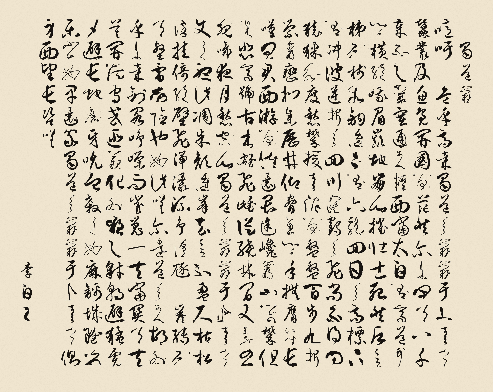

# 张旭 · 怀素 · 李白 · 贺知章 等稀缺名家书法单字库

从公有领域 / 开放授权的传世原作逐字切出的单字图库，附出处、切框、释文与真伪标注，并带集字成篇脚本。收录张旭、怀素、李白、黄庭坚草书、颜真卿《祭侄文稿》、贺知章《孝经》、杜牧《张好好诗》、高闲《千字文》八家，共约 4000 字。

**授权：非商业免费，商业须付费授权。** 代码 PolyForm Noncommercial 1.0.0（`LICENSE`），字图与数据 CC BY-NC 4.0（`LICENSE-DATA`），商用见 `COMMERCIAL.md`，图源署名见 `SOURCES.md`。

署名示例：「字图来自 LMH-gh《稀缺名家书法单字库》，CC BY-NC 4.0；原作藏 XX」

*《蜀道难》张旭集字：张旭 99 字，其余以孙过庭草书补，「嚱」「砯」各家皆无，留空。*

---

# 自建名家书法单字库 · 规范与说明（2026-11-12）

## 一、目录结构
- data/masters/<书体>-<书家>/<简体字>/<出处>_<编号>.png ：白底黑字单字图（ok 级）
- data/masters/<书体>-<书家>/index.json ：每字一条（出处、行号、框坐标、原字形 orig、conf、note），sources 段写作品、藏地、授权、真伪
- data/masters/_review/<书体>-<书家>/ ：存疑（low）字，不参与集字
- scripts/masters.py ：集字生成器；scripts/libsheet.py ：字库对照表
- build/<书家拼音>/ ：各库的释文、切框与重建脚本（原图需按 index.json 里的来源重新下载）
- specs/ ：建库流程 BUILD_LIB_TASK.md、本规范

## 二、建库流程（详见 specs/BUILD_LIB_TASK.md）
1. 鉴别真伪：只收真迹或公认传本；伪托（如张旭《心经》）不收。真伪结论写入 index.json。
2. 取图：只用授权明确可自由使用的图（公有领域 / CC0 / CC BY 等）。授权不明或「版权所有」不用。
3. 释文：按墨迹本身定字，与通行本不同处照原迹收，异文写入 note。重文号「々」、点去字、涂改字不收。
4. 标框：逐行标框，连写分不清、残损、释文拿不准的一律标 low。
5. 蒙版切字：墨迹用自适应阈值；拓本（黑底白字）取白字；按连通域归属切字，避免邻字笔画混入。
6. 自动降级：墨量低于全库中位数 35% 的切字降为 low。
7. 入库：ok 入主库，low 入 _review；生成 index.json 与字库对照表并目检。
8. 注册：在 masters.py 的 REAL 中登记，必要时加 ALIAS。

## 三、已建库清单
| masters 键 | 目录 | 作品 | 图源/授权 | 真伪 | ok 字数/字种 |
|---|---|---|---|---|---|
| 张旭 | 草-张旭 | 古诗四帖、肚痛帖、断千字文 | Commons / Met CC0 / 哈佛拓本（公有领域政策） | 古诗四帖有争议；肚痛帖、断千字文为宋刻 | 271 / 229 |
| 怀素 | 草-怀素 | 自叙帖 | 台北故宫 CC BY 4.0 | 传本（疑宋摹） | 352 / 265 |
| 李白 | 草-李白 | 上阳台帖 | Commons PD | 公认真迹 | 20 / 20（存疑 5） |
| 黄庭坚草书 | 草-黄庭坚 | 廉颇蔺相如传 | Met 1989.363.4 CC0 | Met 定真迹，有异说 | 931 / 300 |
| 颜真卿祭侄 | 行-颜真卿祭侄 | 祭侄文稿 | 台北故宫 CC BY/PD | 公认真迹 | 197 / 175 |
| 贺知章 | 草-贺知章 | 孝经（全文 18 章） | 明治钩摹刻本印本，Commons PD | 传称，学界有异说 | 1695 / 369 |
| 杜牧 | 行-杜牧 | 张好好诗 | 北京故宫整卷，Commons PD | 公认真迹 | 339 / 261 |
| 高闲 | 草-高闲 | 千字文残卷（上博） | Commons PD（图偏小） | 主流真迹，清人有疑 | 207 / 207 |

ALIAS：颠张醉素/张旭怀素 → 张旭+怀素；祭侄文稿 → 颜真卿祭侄；廉颇蔺相如传 → 黄庭坚草书；孝经 → 贺知章；张好好诗 → 杜牧。

## 四、集字用法
python3 scripts/masters.py jizi "全文" --master 张旭 --title 题 --author 作者 [--plain 无印章无注释] [--mark 补字浅墨]
缺字按 孙过庭 > 王铎行草 > 文徵明行草 > 索靖 补，仍缺则跨书体补；missing 为各家都没有的字。

## 五、授权与使用限制
- 自建库图源均为公有领域或开放授权（见 SOURCES.md）；本项目整理成果非商用免费、商用付费（见 COMMERCIAL.md）。
- 原有 19 家真迹数据为 Apache-2.0。
- 方正/汉仪等名家字库（fonts/，未打包）仅限个人学习研究，商用须向厂商购买授权。
